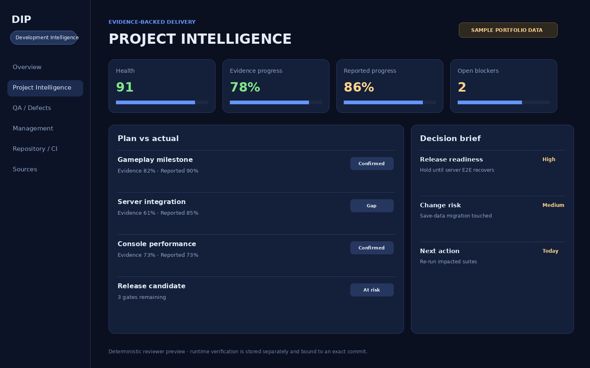
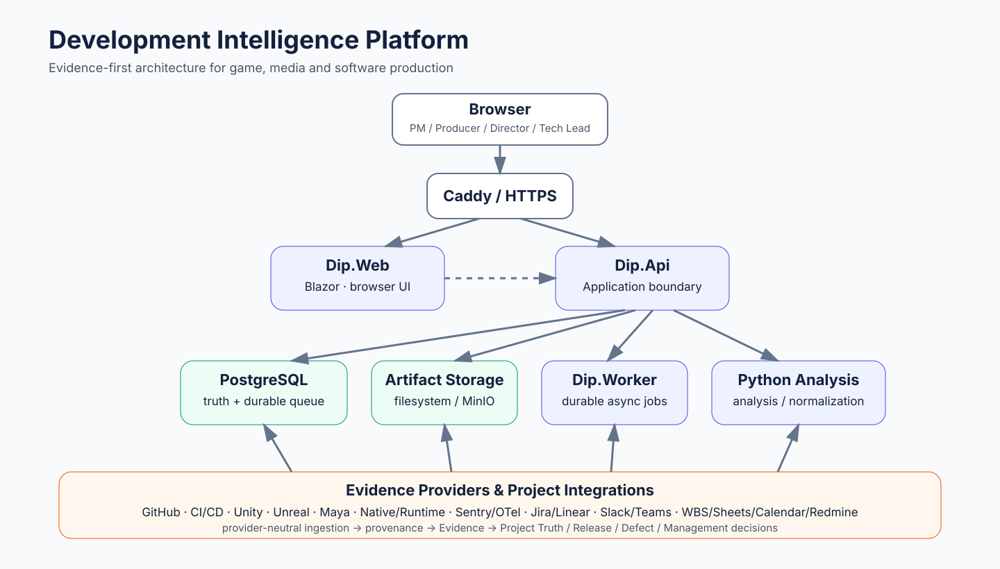
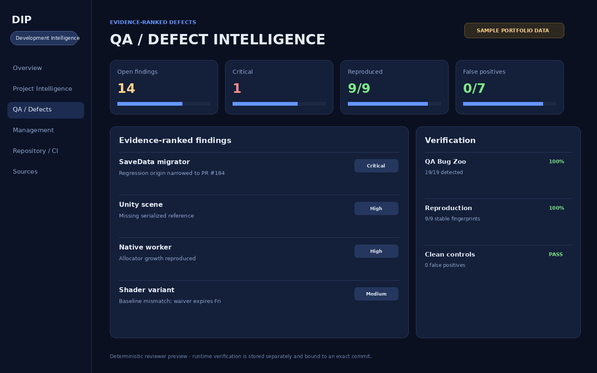
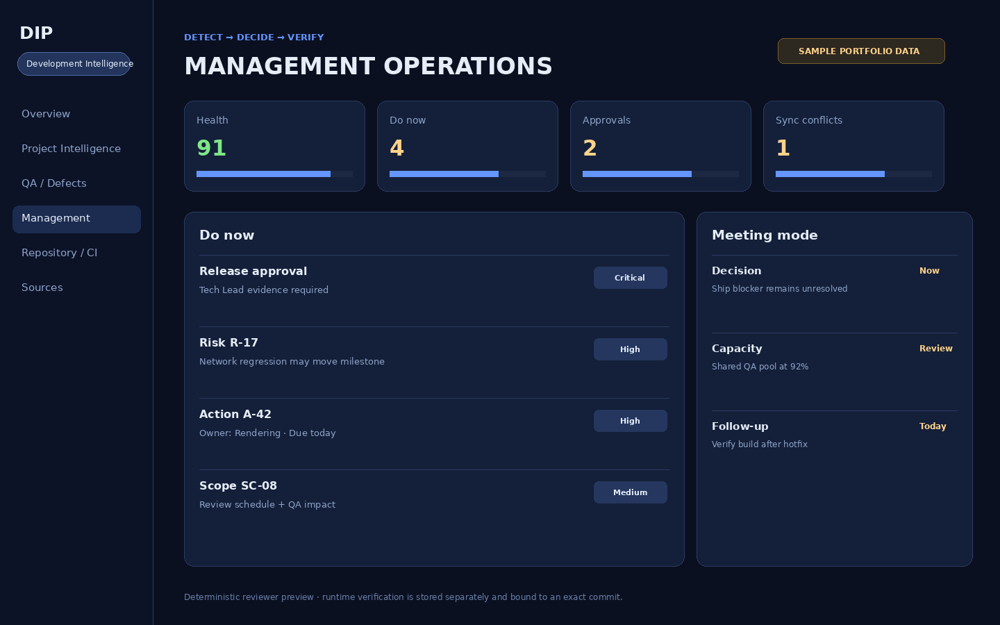

# Development Intelligence Platform

**Development Intelligence Platform (DIP)** is a browser-first development platform that turns fragmented **Git / CI / QA / Runtime / Performance / Project data** into traceable Evidence for game, media, and software production teams.

[](https://github.com/MKyosei2/development-intelligence-platform/actions/workflows/dotnet-ci.yml)
[](https://github.com/MKyosei2/development-intelligence-platform/actions/workflows/integration-test.yml)
[](https://github.com/MKyosei2/development-intelligence-platform/actions/workflows/security-scan.yml)

<p align="center">
  
</p>

> The GIF and checked-in screenshots use deterministic sample portfolio data. They are product demonstrations, not proof that the latest commit passed runtime verification. Exact-revision evidence is tracked separately under [`docs/09-portfolio/evidence/`](docs/09-portfolio/evidence/).

## For reviewers: what is technically difficult here?

DIP is intentionally presented as a **development-platform engineering project**, not only as a PM dashboard. The three main engineering problems are:

1. **Normalize heterogeneous development evidence without losing provenance.** GitHub, CI, build/test results, Unity/Unreal/Maya collectors, native/runtime events, performance measurements, and management integrations are mapped into provider-neutral Evidence while retaining source, revision, time, confidence, and verification boundaries.
2. **Keep durable truth separate from delivery and analysis.** PostgreSQL is the durable source of truth; Redis is used for coordination/delivery; asynchronous work runs through `Dip.Worker`; analysis is isolated behind the Python service. A failure in one adapter must not silently redefine project state.
3. **Do not inherit trust across revisions.** A source file existing is different from that revision being verified. Historical PASS evidence remains useful, but a newer commit must earn its own CI/runtime evidence before it is called verified.

A deeper engineering walkthrough is in [`docs/09-portfolio/ENGINEERING_CASE_STUDY.md`](docs/09-portfolio/ENGINEERING_CASE_STUDY.md).

## What it solves

Large productions spread planning, reporting, GitHub, CI, QA, engine/runtime telemetry, incidents, and release information across separate tools. That makes simple questions expensive:

- What progress is actually supported by evidence?
- Is this revision safe to release?
- Which change is most likely connected to a regression?
- Is the product failing, or is the QA/verification infrastructure itself unhealthy?

DIP normalizes those signals into the same project context and links **Claim → Evidence → Risk → Action → Verification** instead of relying only on self-reported status.

### Project Truth / Evidence Graph

- Separates Claim from Evidence and models `Confirmed / PartiallyConfirmed / Unverified / Contradicted / Stale` relationships.
- Normalizes GitHub / CI / Build / Test / Runtime / Performance / Unity / Unreal / Maya evidence.
- Connects Release Readiness, Risk, Blocker, Milestone, Critical Path, and Change Impact.
- Uses an explicit, versionable `ProjectTruthPolicy` for heuristic thresholds/penalties instead of scattering magic numbers through evaluators.

The default policy preserves historical behavior; it is **not claimed to be statistically optimal**. The calibration and validation boundary is documented in [`docs/09-portfolio/PROJECT_TRUTH_POLICY.md`](docs/09-portfolio/PROJECT_TRUTH_POLICY.md).

### Game Development QA / Defect Intelligence

- Specialized Python / C# / C++ QA plus capability-based adapters for JS/TS/Go/Rust/Java/Kotlin/Ruby/PHP/Shell/Lua/Shader and custom toolchains.
- Unity / Unreal / Native collectors and runtime crash/timeout/memory/race/deadlock evidence.
- Stable fingerprinting, regression origin, isolated Verified Fix, and Game Session Regression Replay.
- Sentry / OpenTelemetry ingestion and QA governance/release gates.

### Management Operations

- Daily Cockpit, Risk / Decision / Action / Approval, RACI, Resource Capacity, and meeting modes.
- Integration layers for GitHub / Jira / Linear / Slack / Teams / Google Sheets / Calendar / Redmine / WBS.
- Evidence-linked `Detect → Decide → Assign → Approve → Act → Verify → Close → Review` workflow.

## Architecture

<p align="center">
  
</p>

```text
Browser
  ↓ HTTPS
Caddy
  ├─ Dip.Web (Blazor)
  └─ Dip.Api
       ├─ PostgreSQL  ← durable source of truth
       ├─ Redis       ← delivery / coordination
       ├─ Dip.Worker  ← async jobs / ingestion
       └─ Python Analysis
             ↑
GitHub / CI / Unity / Unreal / Maya / Native / Runtime / PM tools
```

Detailed boundaries and trust model: [`docs/09-portfolio/ARCHITECTURE_OVERVIEW.md`](docs/09-portfolio/ARCHITECTURE_OVERVIEW.md).

## Portfolio evidence

DIP deliberately distinguishes **implemented source**, **historically verified evidence**, and **exact-revision verification**.

- Historical verified baseline: [`docs/09-portfolio/evidence/verified-baseline/`](docs/09-portfolio/evidence/verified-baseline/)
- Latest package/revision status: [`docs/09-portfolio/evidence/latest-revision.md`](docs/09-portfolio/evidence/latest-revision.md)
- Runtime verification policy: [`docs/09-portfolio/runtime-verification.md`](docs/09-portfolio/runtime-verification.md)
- Detailed implementation/runtime distinction: [`docs/IMPLEMENTATION_STATUS.md`](docs/IMPLEMENTATION_STATUS.md)

Representative **historical verified baseline** values:

| Evidence | Measured result |
|---|---:|
| Project list p95 | **4.174 ms** |
| Collector p95 | **34.507 ms** |
| 100 req/s error rate | **0.0000%** (1,500 requests) |
| 1M Metric query p95 | **363.796 ms** |
| QA Bug Zoo recall | **19 / 19 = 100%** |
| QA clean-control false positives | **0 / 7 = 0%** |
| QA reproducibility | **9 / 9 = 100%** |

These measurements belong only to the exact commit recorded with their evidence. They are not automatically attributed to newer commits.

## Screenshots

| Project Intelligence | QA / Defect Intelligence | Management Operations |
|---|---|---|
|  |  |  |

## Technology

- **Backend / Web:** .NET 8, C#, ASP.NET Core, Blazor
- **Data / jobs:** PostgreSQL, Redis, Worker
- **Analysis / automation:** Python, PowerShell
- **Native / engine:** C++, CMake, Unity, Unreal, Maya collectors
- **Delivery / observability:** Docker, Caddy, GitHub Actions, OpenTelemetry, Prometheus/Grafana
- **Verification:** Unit, Integration, E2E, Playwright UI E2E, load/benchmark, QA Bug Zoo

## Scope and non-goals

DIP is broad because the product boundary is the development pipeline, but breadth is not treated as proof of completeness. The following rules keep the portfolio claims reviewable:

- Source presence is never presented as runtime PASS.
- Optional third-party integrations require configured sandbox/live verification before being called verified.
- AI/Fix Agent output is advisory until an isolated worktree re-runs the required checks and produces evidence.
- Project Truth is a deterministic policy/evidence model, not an employee truthfulness score and not an ML prediction system.
- Engine/device-specific claims remain unverified until the corresponding engine/device runner actually executes them.

## Run for development

For the persistent local stack, copy `.env.example` to `.env`, configure repository access when needed, and run:

```bash
docker compose up -d --build
```

Then open `http://localhost:5081/projects/import/github`.

For hosted/browser-only deployment, use the hardened configuration documented under `deploy/` and `docker-compose.web.yml`; production secrets must stay outside source control.

## Verification

Core Windows verification:

```powershell
powershell -ExecutionPolicy Bypass -File .\scripts\Verify-Solution.ps1
powershell -ExecutionPolicy Bypass -File .\scripts\Verify-QaGovernance.ps1
powershell -ExecutionPolicy Bypass -File .\scripts\Verify-P2.ps1
powershell -ExecutionPolicy Bypass -File .\scripts\Verify-PortfolioFormal.ps1 -UnityPath "<Unity.exe>"
```

Before publication:

```bash
python tools/verify_publication_safety.py --root .
python tools/validate_portfolio_readiness.py --root .
```

A revision is not called complete merely because runners or source paths exist. Publication and release requirements are in [`docs/09-portfolio/PUBLICATION_CHECKLIST.md`](docs/09-portfolio/PUBLICATION_CHECKLIST.md).

## Repository guide

```text
src/                    Domain / Application / Infrastructure / API / Worker / Web
collectors/             Unity / Unreal / Maya / Native / Runtime collectors
services/               Python analysis service
tests/                  Unit / Integration / E2E / UI E2E / load tests
tools/                  QA, evidence, benchmark and publication tooling
scripts/                Windows verification and release helpers
docs/09-portfolio/      Reviewer-facing architecture, evidence and case study
```

- Reviewer brief: [`docs/09-portfolio/reviewer-brief.md`](docs/09-portfolio/reviewer-brief.md)
- Engineering case study: [`docs/09-portfolio/ENGINEERING_CASE_STUDY.md`](docs/09-portfolio/ENGINEERING_CASE_STUDY.md)
- Project Truth policy: [`docs/09-portfolio/PROJECT_TRUTH_POLICY.md`](docs/09-portfolio/PROJECT_TRUTH_POLICY.md)
- Security policy: [`SECURITY.md`](SECURITY.md)
- Contribution guide: [`CONTRIBUTING.md`](CONTRIBUTING.md)

## License

MIT — see [`LICENSE`](LICENSE).
