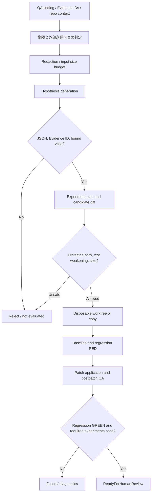

# 生成AIを用いたQAの内部詳細設計

> **文書ステータス:** As-Is の主要処理を確認 / 実LLM効果は未実証  
> **調査基準:** DIP `main` `ae2a78f1c168`、将来資料ブランチ `3587122ad05e`（2026-10-16 確認）  
> **注意:** 文書は設計・検証の説明であり、実機・本番運用の成功を新たに証明するものではない。

## 1. 開発目的と非目的
AI QAは不具合の兆候から**検証可能な仮説・修正候補**を作り、人間の調査を支援する。自然言語出力で品質ゲートを通すこと、無承認自動マージ、実行不能を成功に読み替えることは非目的。

## 2. 内部パイプライン

## 3. 現状の実装接点
| ステージ | 確認した実装 | 主な信頼境界 |
|---|---|---|
| 実験予算・オーケストレーション | `AutonomousDebugService.RunAsync` | hypothesis/experiment/AI callsを制限 |
| オプトインLLM | `OpenAiCompatibleFixProposalAgent` | 有効化時のみ外部API、Evidence ID必須 |
| モデル入力整形 | `GenerativeQaRedactor` | Redactionだけで機密が必ず消えるとは主張しない |
| モデル出力検査 | `GenerativeQaResponseParser` | JSON/ID/サイズ/Path等の境界を検査 |
| 修正検証 | `VerifiedFixService.VerifyAsync` | 使い捨てworktree、生成テスト1〜20、差分制限、red→green |
| 実験実行 | `IAutonomousQaExperimentDispatcher` | 必須実験を満たさずVerifiedにしない |
| 実行隔離 | `ProcessExecutor` / `QaWorkerSandboxRunner` | 設定により環境差；host fallbackの安全性を別監査 |

## 4. 制約と出力モデル（設計規則）
- **要求:** `projectId`, `subjectKey`, `domainId`, 明示的なEvidence ID、対象SHA、実行予算。
- **仮説:** `id`, `evidenceIds`, `confidence`, `suggestedExperiments`, 未確定理由を保持。
- **候補:** `unifiedDiff`、新規回帰テスト、Evidence参照、生成器のモデル／設定版。
- **結果:** `Failed`、`NoGroundedHypothesis`、`ReadyForHumanReview`などの状態に加えて、それぞれの失敗理由・実行ログを保存。名称は実行時DTOを正とする。
- **禁止:** 無検証で`Verified`、実行前後でテストをすり替える、セキュリティ設定変更、機密情報の未承諾外部送信。

## 5. Red→Greenの正しい意味
「生成された回帰テストがパッチ前に失敗し、パッチ後に成功する」だけでも十分でない。既存アダプターのQA、必須Experiment、重大Findingの増減を確認し、テスト自体の有効性を別途評価する。テスト対象外の挙動まで修正されたとは推定しない。

## 6. 失敗注入テスト
| 入力 | 期待する拒否 | 主要テスト |
|---|---|---|
| 未知Evidence ID | 仮説・修正採用なし | `GenerativeQaResponseParserTests` |
| 禁止ファイルを編集 | Patch reject | `VerifiedFixServiceTests` |
| 生成テストなし | Verified不可 | `VerifiedFixServiceTests` |
| 外部APIが無効 | LLM Runtime Verified不可 | `OpenAiCompatibleFixProposalAgentTests`（スタブと区別） |
| Redが成立しない | ReadyForHumanReview不可 | `VerifiedFixServiceTests` |
| 無隔離・不許可ネットワーク | Protected execution拒否 | `ProcessExecutorSandboxTests` |

## 7. 未実証の境界・優先課題
実APIモデルを使う最終SHAに紐付いた評価データ、実ゲームのバグに対する正解率、検査負荷・コスト、パッチ提案の誤り率は本設計書からは実証できない。`docs/08-testing/ai-qa-evaluation-protocol.md`の再現可能な試験で補う。

## 参照する実装・既存資料

- `src/Dip.Application/Features/QualityAutomation/AutonomousDebugService.cs`
- `src/Dip.Infrastructure/P2Intelligence/OpenAiCompatibleFixProposalAgent.cs`
- `src/Dip.Infrastructure/QualityAutomation/VerifiedFixService.cs`
- `docs/09-portfolio/GENERATIVE_QA.md`
- `tests/Dip.Infrastructure.Tests/QualityAutomation/VerifiedFixServiceTests.cs`

## レビュー・受け入れチェック

- [ ] 実LLMを使う検証とスタブテストを別欄に示せる
- [ ] Patch前後で同一回帰テストを実行する証拠がある
- [ ] 外部送信可能なデータの範囲・承認条件が決まった
- [ ] 実行時に機密・ホストへのアクセスを遮断する証拠がある
