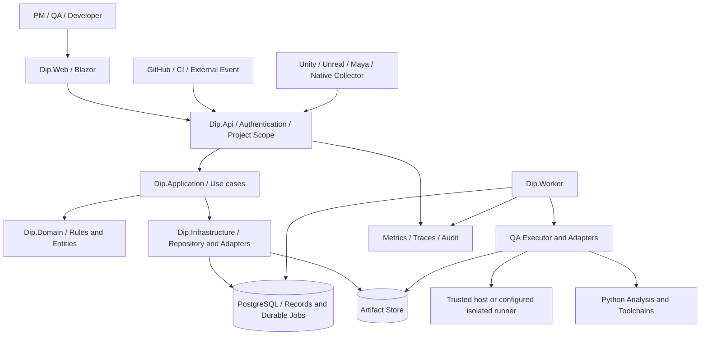

# システム詳細アーキテクチャ（現行コード基準）

> **文書ステータス:** As-Is のコード境界確認済み / 実動作は個別Evidenceが必要  
> **調査基準:** DIP `main` `ae2a78f1c168`、将来資料ブランチ `3587122ad05e`（2026-10-16 確認）  
> **注意:** 文書は設計・検証の説明であり、実機・本番運用の成功を新たに証明するものではない。

## 1. 境界と責務
DIPは単一巨大クラスではなく、`Web` → `Api` → `Application/Domain` → `Infrastructure` の依存境界と、PostgreSQLを中心とした永続化、別プロセスのWorker、外部Collectorを持つ。

**境界の読み方:** `ENV`には隔離方式の選択肢がある。`QaWorkerSandboxRunner`が実装されていても、全環境で外部隔離が常に構成・検証済みとは言えない。Docker、VM、GPU Runnerは環境条件に依存する。

## 2. コンポーネント契約
| コンポーネント | 主な責務 | 禁止すべき責務の侵食 | 主要ソース |
|---|---|---|---|
| `Dip.Web` | ユーザー向け表示、API利用 | クライアント単独で品質PASSを決定 | `src/Dip.Web/` |
| `Dip.Api` | 入力検証、認証、Projectスコープ、HTTP境界 | 任意の入力でホストコマンド実行 | `src/Dip.Api/Controllers/`、`Authorization/` |
| `Dip.Application` | QA計画、Claim/Evidence、Release判断、Use case | 技術別の実行詳細をドメインに漏出 | `src/Dip.Application/Features/` |
| `Dip.Domain` | 状態遷移、不変条件、列挙値 | HTTP・ファイルシステム・DBへの依存 | `src/Dip.Domain/Features/` |
| `Dip.Infrastructure` | Repository、Git作業領域、アダプター、実行器 | 入力の信頼を無検証で昇格 | `src/Dip.Infrastructure/` |
| `Dip.Worker` | Durable Jobの非同期消費と結果反映 | 他プロジェクトジョブの処理混入 | `src/Dip.Worker/` |
| Collector | エンジンや外部ツールの観測 | 未実行検査のPASS表明 | `collectors/`、`plugins/` |

## 3. 三つの柱の接続
1. **Game Development QA**は対象SHAと実行環境を明示したFinding・Metric・Artifactを生成する。
2. **Project Truth**は申告とEvidenceを異なる入力として扱い、改訂版・信頼度・鮮度を評価する。
3. **Verification / Release**はQAとProject Truthの出力を使うが、発行された判断と最終ポートフォリオPASSは別の契約を持つ。

## 4. 信頼境界
- **外部入力境界:** Collector report、Webhook、モデル出力は信頼しない。形式・権限・内容・サイズの検証を要する。
- **実行境界:** QAコードは第三者ソースを処理し得る。サンドボックス未利用時に安全な隔離済みとは主張しない。
- **改訂版境界:** DIP自身のSHAと評価対象のゲーム／ツールSHAを分離する。
- **データ境界:** Project IDに対する認可はAPI・サービス・Artifact全てで必要。UIの表示制御だけでは不十分。

## 5. 見落としやすい設計上の課題
- API入力に`ProjectId`がある全経路と、ネストしたリソースIDの所有権を網羅した認可検査が必要。
- ジョブが異常終了しても`Success`にならないこと、同一Jobの再試行を別の独立Evidenceとみなさないこと。
- Unity/Unreal向けコードは実Editorを起動する経路を持つが、本リポジトリのCI成功だけで両方の実ランタイムを証明しない。
- Releaseの`ConditionalGo`とポートフォリオの最終`PASS`は異なる意味を持つ。

## 6. 必須図の更新手順
今後コンポーネントを追加する際は「どこから入力されるか／どこに保存されるか／どの障害が伝播するか／誰が認可するか」を表に1行追加し、実装ファイルとテスト参照を記載する。未実装の要素は点線ではなく文書上で`Proposed`と明示する。

## 参照する実装・既存資料

- `docs/02-architecture/system-context.md`
- `docs/09-portfolio/ARCHITECTURE_OVERVIEW.md`
- `src/Dip.Api/Program.cs`
- `src/Dip.Application/Features/ProjectTruth/ProjectTruthService.cs`
- `src/Dip.Application/Features/QualityAutomation/QaOrchestrationService.cs`
- `src/Dip.Infrastructure/QualityAutomation/QaWorkerSandboxRunner.cs`

## レビュー・受け入れチェック

- [ ] 図の全コンポーネントに対応する現存コード／外部依存がある
- [ ] すべての信頼境界に認証／検証／責任者を割り当てた
- [ ] 実環境での動作主張がEvidenceと対応している
