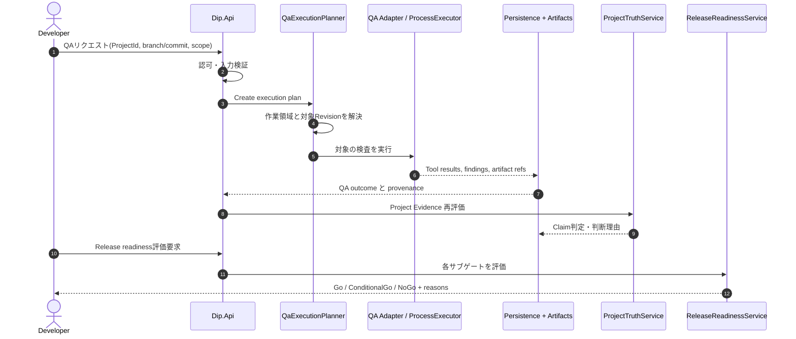

# QA → Evidence → Project Truth → Release のシーケンス仕様

> **文書ステータス:** As-Is を元にした論理シーケンス / 実API細部は追跡対象  
> **調査基準:** DIP `main` `ae2a78f1c168`、将来資料ブランチ `3587122ad05e`（2026-10-16 確認）  
> **注意:** 文書は設計・検証の説明であり、実機・本番運用の成功を新たに証明するものではない。

## 1. 正常系：QA結果が意思決定に反映されるまで

**注意:** この図は各実装の責務を集約した概念的なE2E図。QA終了とTruth再計算が必ず同一HTTPリクエスト中で同期実行されることまでは主張しない。正確なトリガーと永続化時点は対象API・Worker・E2Eテストで確認する。

## 2. 異常系と期待状態
| 異常 | 入力を受けた層 | 期待する処理 | 絶対に避ける誤表現 |
|---|---|---|---|
| Project権限なし | API | 403相当、監査、未実行 | QA成功・認可済み |
| 対象SHAを解決できない | Planner | Blocked/実行不能、理由記録 | current PASS |
| ツール未インストール | Adapter | NOT_EVALUATED系、カバレッジ欠損 | 失敗検査0件＝PASS |
| コマンドTimeout | Executor | プロセス終了、失敗理由・制約保存 | Product PASS |
| Worker死亡 | Queue/Worker | Lease期限後に再試行／上限到達で失敗 | 2回成功として二重カウント |
| DB保存失敗 | Persistence | 成果物と記録の未確定状態を残す | 完了済みEvidence |
| 別コミットのArtifact | Evidence | 履歴としてのみ保持、現在証拠に昇格しない | 最新SHA Verified |
| 重大QA Finding + 完了申告 | Truth | Contradicted / Gate Failed | 完了済み |
| Release bundleのSHA不一致 | Release | 少なくとも警告；厳格配布条件では阻止を検討 | 改訂版の一致証明 |

## 3. 不変条件と順序
- 入力時点でActor・Project・Resourceの権限を検査する。
- QA実行前に対象のリビジョンを固定し、最後にそのSHAをEvidenceへ載せる。
- 検査の結果と、検査が実行できたかの状態を別フィールド／概念で管理する。
- DB記録とArtifact間で部分成功を監視し、遅延・重複・欠損を再処理できる設計にする。
- AIモデルが生成した説明文は観測値の代用にしない。

## 4. 検証シナリオ例
| ケース | 期待結果 | Evidence |
|---|---|---|
| SYN-E2E-01: Critical Finding + Complete | Quality Gate Failed、Claim Contradicted | E2E assert + final JSON |
| SYN-E2E-02: 古いSHAのPASS | 新SHAの確認不能 | revisions付き2レコード |
| SYN-E2E-03: 収集空配列 | Coverage不足、不正なPASSなし | metrics/issues空レポート |
| SYN-E2E-04: Worker途中死 | 再試行またはterminal failure、重複確定なし | Job履歴、Lease、出力ハッシュ |
| SYN-E2E-05: Artifact hash mismatch | Evidence未検証 | 破損ファイルと期待digest |

## 5. 実行結果に残す識別子
`ProjectId`、`RunId`、`JobId`、`SourceDIPSha`、`TargetSha`、`ToolVersion`、`ArtifactDigest`、`ObservedAtUtc`、`CorrelationId`（フィールド名は論理名。実際のJSON Schemaとは区別）。

## 参照する実装・既存資料

- `tests/Dip.EndToEndTests/Scenarios/GameDevelopmentEvidenceScenario.cs`
- `tools/publish_qa_scenario_evidence.py`
- `src/Dip.Application/Features/QualityAutomation/QaExecutionPlanner.cs`
- `src/Dip.Application/Features/Release/ReleaseReadinessService.cs`

## レビュー・受け入れチェック

- [ ] 異常系にPASSへの誤変換がない
- [ ] Actor/Project/対象SHA/Artifactが追跡できる
- [ ] 図とE2Eテストで処理順序の差異が説明されている
