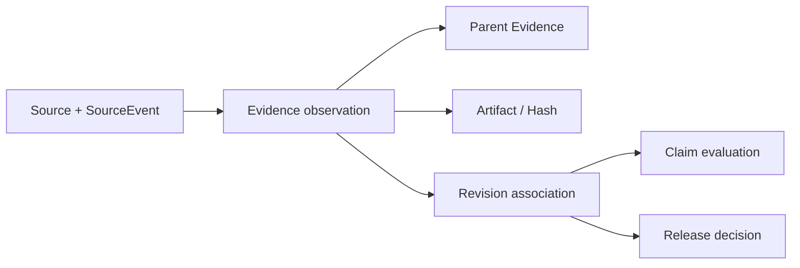

# Evidenceの改訂版・来歴・完全性契約

> **文書ステータス:** As-IsのEvidence V2確認 / 厳格化案を含む  
> **調査基準:** DIP `main` `ae2a78f1c168`、将来資料ブランチ `3587122ad05e`（2026-10-16 確認）  
> **注意:** 文書は設計・検証の説明であり、実機・本番運用の成功を新たに証明するものではない。

## 1. Evidenceの存在理由
DIPのEvidenceは「誰が正直か」を評価しない。「何が観測されたか」を同じ対象・改訂版で検査可能にする。実装上の`EvidenceRecord`には`ProjectId`, `PipelineRunId`, `SubjectKey`, `SourceType`, `EvidenceKind`, `Outcome`, `Confidence`, `ObservedAtUtc`があり、V2として`SourceInstanceId`, `SourceEventId`, `ArtifactId`, `ContentHash`, `ParentEvidenceId`, `PrivacyClass`, `IntegrityStatus`等がある。

## 2. モデルと来歴

| 分離したい概念 | なぜ分けるか |
|---|---|
| `DipCommitSha` vs `TargetCommitSha` | DIPの実装版と対象ゲームの版は別物 |
| Tool PASS vs Quality PASS | ツール実行成功は対象品質の保証でない |
| Observation vs Interpretation | 記録の真正性と判定ルールの妥当性は別 |
| `LegacyUnsigned` vs cryptographically verified | 旧記録が存在することと署名確認は別 |
| ProducedAt vs IngestedAt | 遅延・replay・鮮度評価のため |

## 3. 不変条件
- `SourceInstanceId + SourceEventId`等から重複入力を識別する。判定後に同一実行を独立した支持Evidenceとして水増ししない。
- 対象リビジョンが一致しないEvidenceは履歴として保持できるが、最新の検証結果として昇格しない。
- `ContentHash`などの整合性を検証して初めて強い信頼を与える。添付ファイルの存在確認だけでは不十分。
- 重大な失敗Evidenceが真実の観測である場合、Evidenceの成功/失敗ではなく、観測の完全性・適用性を評価する。
- `LegacyUnsigned`を`Verified`と同等の暗号学的保証として宣伝しない。現行の`EvidenceConfidenceEvaluator`は`Verified`または`LegacyUnsigned`を集約対象とするため、厳格化の要否を確認する。

## 4. 信頼レベルを上げる追加案
| 信頼レベル | 提案要件 | ステータス |
|---|---|---|
| Unverified | 未署名・内容未検証 | 既存概念 |
| Observed | Toolが実行し、ログの存在と形式を検査 | 提案整理 |
| IntegrityChecked | SHA/ハッシュ/サイズが一致 | 提案整理 |
| SourceAuthenticated | Producer署名と権限検証 | 追加検討 |
| RuntimeVerified | 実ターゲットで再実行し、環境を記録 | 実証要件 |

## 5. 攻撃・欠損シナリオ
| 入力 | 望ましい判定 | 検証方法 |
|---|---|---|
| 成功ログの別SHA付け替え | current revisionから除外 | revisionsの入替テスト |
| Artifactの1 byte書換 | integrity invalid | ハッシュ不一致 |
| 同一Jobを3回再送 | 1検査として計数 | 冪等投入 |
| SourceEventIdの偽装 | 認証しない限り拒否または弱い信頼 | Producer証明なしテスト |
| 不適切な旧版無署名Evidence | verifiedへの無根拠昇格を防ぐ | LegacySigned/Unsigned分類テスト |
| Evidenceが無い | Unverified / NotEvaluated | 空入力テスト |

## 6. 実装移行の考慮
新しい必須フィールドを導入する場合、既存`EvidenceRecord`の旧コンストラクタを使うデータに対してマイグレーション・閲覧互換・拒否条件を別途用意する。後方互換がない変更はAPI/DB/Worker/Collectorを一括で切り替えず段階導入する。

## 参照する実装・既存資料

- `src/Dip.Domain/Features/Evidence/Entities/EvidenceRecord.cs`
- `src/Dip.Application/Features/ProjectTruth/EvidenceConfidenceEvaluator.cs`
- `src/Dip.Application/Features/Evidence/EvidenceIntegrityVerifier.cs`
- `docs/10-future/architecture/ARCH-004-EVIDENCE-CHAIN.md`
- `docs/09-portfolio/THREE_PILLAR_PRECISION_CONTRACT.md`

## レビュー・受け入れチェック

- [ ] LegacyUnsignedの信頼分類と実運用上の制約を合意した
- [ ] DIP SHAとTarget SHAが全レポートで区別される
- [ ] Artifact改ざん・再送・別SHAに対する負例を実施した
