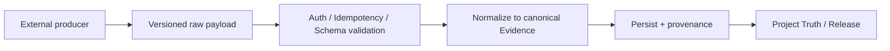

# Collector・外部API・Evidenceのバージョン移行設計

> **文書ステータス:** 既存契約の存在確認 / 互換ポリシーは提案  
> **調査基準:** DIP `main` `ae2a78f1c168`、将来資料ブランチ `3587122ad05e`（2026-10-16 確認）  
> **注意:** 文書は設計・検証の説明であり、実機・本番運用の成功を新たに証明するものではない。

## 1. 目的
GitHub、Unity/Unreal、Maya、Python/C++解析、外部PMツール、生成AIからの入力を、DIP固有のDomainモデルへ安全に正規化する。外部Toolのバージョンアップで古いデータが黙って最新データへ昇格することを防ぐ。

## 2. 境界

## 3. 推奨する契約フィールド
| Field | 必要性 |
|---|---|
| `schemaVersion` | 読み込める版を判定 |
| `producer`と`producerVersion` | 発信者と実行Toolの版 |
| `sourceEventId` / `idempotencyKey` | 再送重複を防ぐ |
| `projectId`, `subject`, `targetSHA` | 対象資源と改訂版を固定 |
| `timestamp`, `environment` | 鮮度・エンジン・OSの比較 |
| `payloadDigest`, `artifactDigest` | 内容を再検証 |
| `coverage`と`status` | 実行未完了・不在とPASSを分離 |

## 4. バージョン規則案
- 新フィールド追加は後方互換か評価し、古いAdapterでも必須の情報を失わないか調べる。
- `schemaVersion`不明の場合はReject/Quarantineし、適当な既定値で成功としない。
- 後方互換ではない変更は新Versionを発行し、受信側は旧版と新仕様の違いを記録する。
- Producerが生成するResultと、DIPが評価するDecisionのスキーマを分離する。

## 5. 必須負例
未知Schema、必須SHAなし、別Project ID、署名なしWebhook、二重送信、Payload size超過、時刻が未来、部分的に欠けたTool coverage。公開ドキュメントにはTokenや未公開アセットを埋めない。

## 6. 検証
Collector report validator、Evidence ingestion、API境界、Project Truthへの統合で同じ入力の整合を確認する。Schemaを更新するPRは同時にProducer/Consumer互換MatrixとMigration計画を追加する。

## 参照する実装・既存資料

- `docs/02-architecture/architecture-decisions/ADR-005-collector-contract.md`
- `docs/04-api/collector-api.md`
- `src/Dip.Application/Features/Collectors/CollectorReportValidator.cs`
- `src/Dip.Application/Features/Evidence/EvidenceIngestionService.cs`
