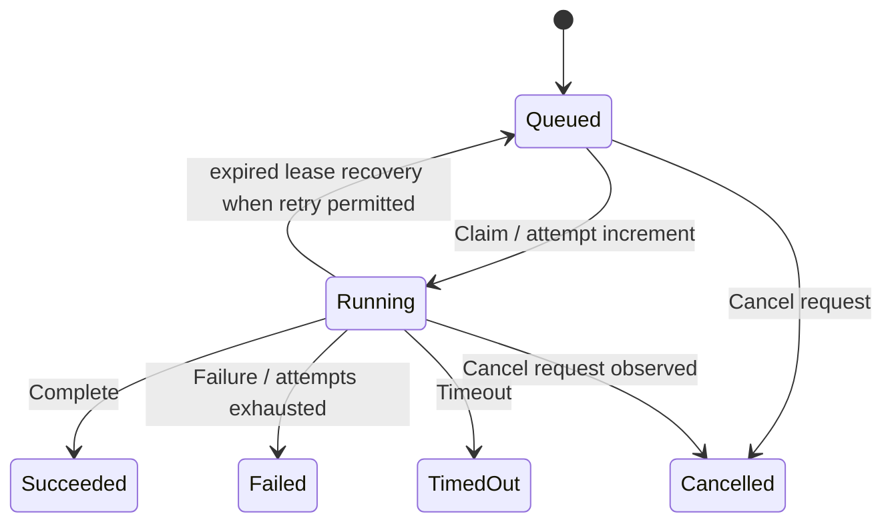
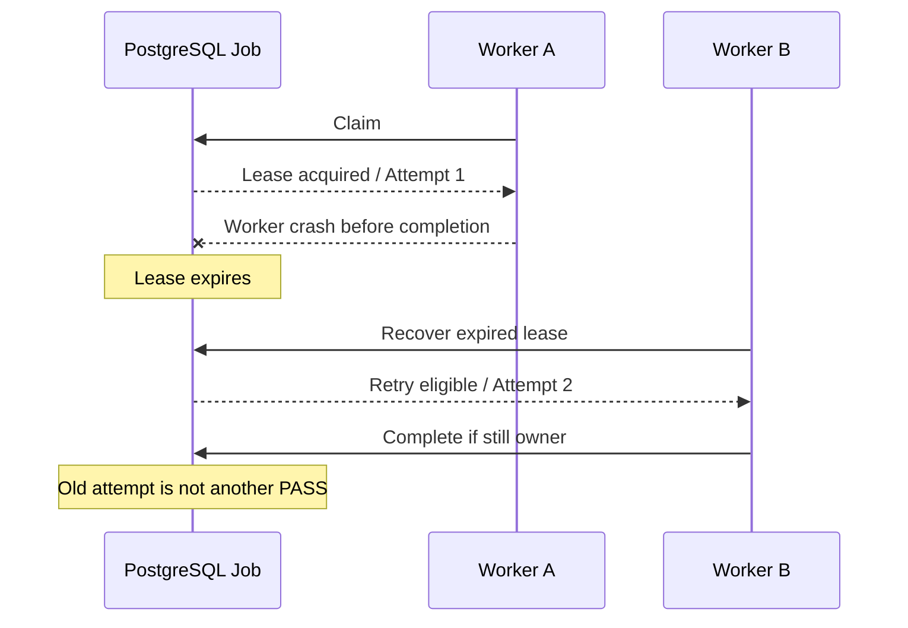

# QAジョブ・Lease・再試行・キャンセル詳細設計

> **文書ステータス:** As-Is のDurableJobモデル確認 / 統合動作の一部は要実証  
> **調査基準:** DIP `main` `ae2a78f1c168`、将来資料ブランチ `3587122ad05e`（2026-10-16 確認）  
> **注意:** 文書は設計・検証の説明であり、実機・本番運用の成功を新たに証明するものではない。

## 1. 現行のDurableJob状態モデル
`DurableJob`は`Queued`、`Running`、`Succeeded`、`Failed`、`Cancelled`、`TimedOut`等を保持する。`Attempt`、`MaxAttempts`、`HeartbeatAtUtc`、`LeaseOwner`、`LeaseExpiresAtUtc`、`CancellationRequestedAtUtc`によって実行権・中断意図を追跡する。

## 2. 状態遷移のルール
| イベント | 前提 | 更新 | 不許可な状態 |
|---|---|---|---|
| Claim | Queued、取消なし、残試行あり | Running、Owner、Lease期限、Attempt+1 | 同一ジョブ二重所有 |
| Heartbeat | Running、正しいOwner | Lease延長、進捗更新 | 別WorkerによるLease延長 |
| Complete | Running | 終端、結果保存、Lease解除 | 既に取消・失敗したJobの成功化 |
| Cancel request | Queued/Running | 取消意図を記録、Queuedは即Cancel可 | 完了済みJobの改ざん |
| Recover expired lease | Runningで期限超過 | 残試行なら再配車、超過ならFailed | 古いOwnerが後から完了確定 |

## 3. 並行・整合性に関する要件
- DB側のClaim処理は原子的に行い、同じJobを同時取得できないようにする。Repository実装とDBの競合試験で検証する。
- `JobId + Attempt`をログ、Artifact、結果へ持たせる。Retryした成果物を独立した検証成功として二重カウントしない。
- 実行ジョブの消費側が副作用を持つ場合、Idempotency Keyを外部側へ渡すか、効果を一度だけ確定する補償処理を設計する。
- Worker死亡後にプロセスが残っていれば、安全な再実行とは呼べない。子プロセス回収・資源封鎖の試験が必要。

## 4. 一例：異常時シーケンス

## 5. 計測・運用対象
`queue_age_seconds`, `running_jobs`, `lease_expiries`, `retry_count`, `cancel_ack_latency`, `failed_jobs`, `orphan_process_count`, `artifact_write_failures`を監視候補とする。これらのメトリクス名は**設計例**であり、実装名が同じとは限らない。

## 6. テストセット
- 2 Worker同時Claim、Lease期限前の横取り拒否、古いOwnerによるHeartbeat拒否。
- RuntimeTimeout、Cancel、MAX_ATTEMPTS到達、Worker kill、DB再起動。
- 同一出力の重複書込、部分Artifactのみ作成、ジョブ完了直前のDB切断。
- いずれも「実行不能」をPASS扱いしない。

## 参照する実装・既存資料

- `src/Dip.Domain/Features/Operations/Entities/DurableJob.cs`
- `src/Dip.Application/Features/Jobs/P2JobEnqueueService.cs`
- `src/Dip.Worker/`
- `tests/Dip.Domain.Tests/PlatformIntelligence/DurableJobTests.cs`

## レビュー・受け入れチェック

- [ ] Lease競合と死活監視の統合テストがある
- [ ] JobId＋Attempt＋SHAが終端Artifactへ伝播する
- [ ] 障害後に重複確定や孤児プロセスが残らない
