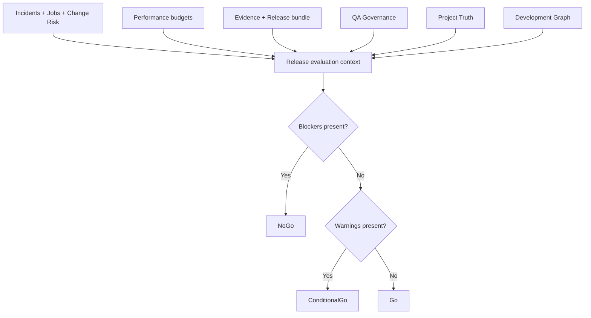

# Release Readiness / Final Evidenceの判定境界

> **文書ステータス:** As-IsのRelease Service確認 / 商用向け強化案を含む  
> **調査基準:** DIP `main` `ae2a78f1c168`、将来資料ブランチ `3587122ad05e`（2026-10-16 確認）  
> **注意:** 文書は設計・検証の説明であり、実機・本番運用の成功を新たに証明するものではない。

## 1. 混同してはいけない2種類の判定
- **製品のReleaseReadinessService:** 候補プロジェクトのQA、Performance、Project Truth、Incidents、Jobs等を集約して`Go / ConditionalGo / NoGo`を決める。
- **DIPポートフォリオ最終Evidence:** 同一DIP SHAのCI、QA Bug Zoo、Benchmark、Project Truthシナリオなどを束ねる別の検証契約。GitHubのワークフローGreenだけで全項目PASSを主張しない。

## 2. 現行サービスの合成

## 3. 現行コードの注意点
`ReleaseReadinessEvidenceEvaluator`は対象コミットのRelease Evidence/SBOM bundleが無い・一致しないときに**Warnings**へ追加している。そのため、他のBlockerがなければ`ConditionalGo`になり得る。"不正なSBOMなら必ずNoGo"という現在未実装の厳格ルールは事実として書かない。

## 4. 商用リリース向け推奨ポリシー（Proposed）
| 条件 | 開発・内部デモ | 外部配布候補 | 商用本番候補 |
|---|---|---|---|
| 現SHAとCI不一致 | 要注意 / 未検証 | NoGo | NoGo |
| 必須QA不足 | NotEvaluated | NoGo | NoGo |
| Critical Finding | NoGo | NoGo | NoGo |
| Provenance/SBOMなし | ConditionalGo候補 | NoGo | NoGo |
| 署名・ハッシュ不一致 | NoGo | NoGo | NoGo |
| インシデント未解決 | 原因に応じ判断 | 原則NoGo | NoGo |
| 人の承認なし | 内部デモのみ | NoGo | NoGo |
| Rollback・DR未確認 | 明記して限定利用 | 条件付き | NoGo |

この表は**提案ポリシー**であり、現行コードの動作保証ではない。厳格化を採用するならポリシーVersionと対象Release Profileを設定できる設計が必要。

## 5. 必須の負例
偽造Commit、空QA結果、古いベンチマーク、別SHAのCI、ハッシュ破損、必須Report不足、Sbomなし、Waiver期限切れ、承認者の自己承認、取消済みRelease候補。

## 6. 最終Evidenceのテンプレート
`dipCommit`, `targetCommit`, `ciRunIds`, `qaArtifactDigest`, `benchmarkDigest`, `projectTruthAssertions`, `releaseBundleDigest`, `policyVersion`, `verdict`, `blockers`, `warnings`, `signingIdentity`を候補に、実実装のスキーマと整合させる。

## 参照する実装・既存資料

- `src/Dip.Application/Features/Release/ReleaseReadinessService.cs`
- `src/Dip.Application/Features/Release/ReleaseReadinessEvidenceEvaluator.cs`
- `src/Dip.Application/Features/Release/ReleaseReadinessQaEvaluator.cs`
- `tools/finalize_portfolio_evidence.py`
- `docs/09-portfolio/THREE_PILLAR_PRECISION_CONTRACT.md`

## レビュー・受け入れチェック

- [ ] 商用厳格ゲートと現在のConditionalGoを区別した
- [ ] NoGo／ConditionalGo／Goの全テスト入力を用意した
- [ ] Same SHAとArtifact digestの負例が確認できる
