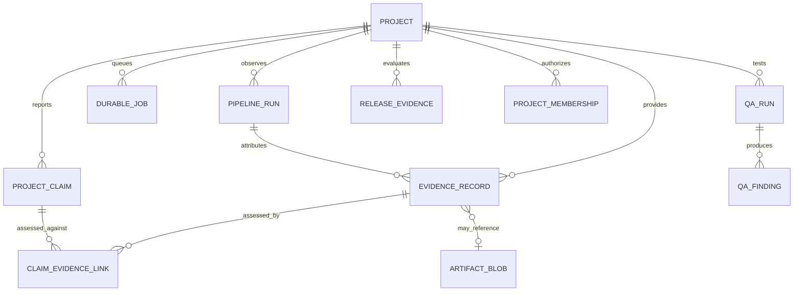

# Project / QA / Evidenceの論理データモデル

> **文書ステータス:** As-Isのエンティティ確認 / テーブル物理名はMigrationで照合  
> **調査基準:** DIP `main` `ae2a78f1c168`、将来資料ブランチ `3587122ad05e`（2026-10-16 確認）  
> **注意:** 文書は設計・検証の説明であり、実機・本番運用の成功を新たに証明するものではない。

## 1. 範囲
既存`schema.md`ではProject/Pipeline/Metric/Issueが中心だった。本書はClaim、Evidence、Job、Artifact、Release、Identity/Project Membershipを含む、**概念上のデータのつながり**を説明する。図にあるERエンティティ名は論理名であり、実際のテーブル名・FKをそのまま表すわけではない。

## 2. 一意性・整合性の候補
| 論理Entity | 主キーの概念 | 検証条件 | 索引候補 |
|---|---|---|---|
| Project | `ProjectId` | 存在、アーカイブ/削除状態 | Owner/Tenant＋state |
| PipelineRun | `RunId` | Project所有権、revision追跡 | Project＋Commit＋startedAt |
| EvidenceRecord | `EvidenceId` | SourceEvent重複防止、Integrity | Project＋Subject＋observedAt |
| ProjectClaim | `ClaimId` | Claim状態・報告者・Project | Project＋Subject＋claimedAt |
| ClaimEvidenceLink | Composite link ID | ClaimとEvidenceの同Project制約 | ClaimId＋EvidenceId |
| DurableJob | `JobId` | Lease owner、attempt、terminal state | status＋leaseExpiry＋project |
| QA Run / Finding | `QaRunId` / `FindingId` | run→project、source SHA | Project＋revision＋severity |
| Artifact | `ArtifactId` / digest | digest・path・tenant ownership | digest、retention deadline |
| Release bundle | `BundleId` | commit一致、完全性 | Project＋commit＋createdAt |

## 3. 実体設計上の確認事項
- 物理テーブルとFK、Cascade規則、Unique Indexは`DbContext`とEF Migrationを正とする。**このMarkdownだけでDB schemaを確定しない。**
- ファイル本体をRDBへ保存するか、Artifact Storeへ保存して参照だけDBへ置くかはBlob実装を確認する。
- SHA・Digestは用途別に区別し、テキストの`SHA`と暗号学的なハッシュを混同しない。
- EvidenceとClaimを同一トランザクションで更新するか、結果整合モデルにするかは性能と監査要件を踏まえて明示する。

## 4. テナント分離・削除
マルチテナント提供時は全EntityのTenant/Project間接所有権を検証し、検索・バッチ・バックアップ・Artifact配布経路の漏えいを拒否する。顧客の削除要求はDBレコードだけでなく、Artifact、検索index、キャッシュ、バックアップ期限、外部連携に及ぶ。

## 5. Migration検証
クリーンDB、レガシーDB、migration実行中断、再実行、rollback（対応範囲内）、不整合旧schemaのfail-closedを別々のケースとして実施する。

## 参照する実装・既存資料

- `docs/03-database/schema.md`
- `docs/03-database/migration-policy.md`
- `src/Dip.Domain/Features/Evidence/Entities/EvidenceRecord.cs`
- `src/Dip.Domain/Features/Operations/Entities/DurableJob.cs`
- `src/Dip.Domain/Features/Evidence/Entities/ProjectClaim.cs`
- `src/Dip.Domain/Features/Identity/Entities/ProjectMembership.cs`

## レビュー・受け入れチェック

- [ ] ER図の関係が現行EF Core Mappingに一致する
- [ ] テーブル名・主キー・FK・UniqueIndexをMigrationから埋めた
- [ ] アクセス境界をDB/Artifact両方で検証した
