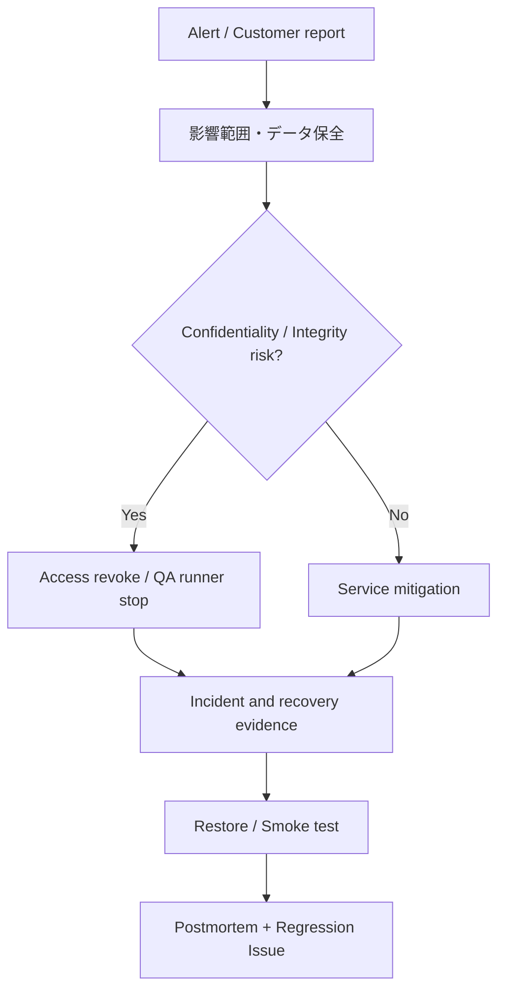

# インシデント対応と復旧手順カタログ

> **文書ステータス:** Proposed Runbook / 24時間対応体制は未構築  
> **調査基準:** DIP `main` `ae2a78f1c168`、将来資料ブランチ `3587122ad05e`（2026-10-16 確認）  
> **注意:** 文書は設計・検証の説明であり、実機・本番運用の成功を新たに証明するものではない。

## 1. 状況記録のひな型
`IncidentId / severity / detectedAt / startedAt / affectedProjects / symptom / logs and traceIds / mitigation / owner / recoveryAt / rootCause / followUpIssue`。公開レポートにはSecretと顧客の未公開コードを含めない。

## 2. 初動フロー

## 3. 代表ケース
| Incident | 初動 | 復旧と受け入れ |
|---|---|---|
| API 5xx増加 | Deploy/DB/Auth変更履歴確認 | 直近成功版でSmoke、p95回復 |
| Queue starvation | Worker/Lease/DB lock確認 | 停滞job処理、重複なし |
| Artifact hash mismatch | 関連Evidenceを未検証扱い | 元Artifact再取得・digest一致 |
| LLM/外部API停止 | 新規AI候補を停止/未評価 | 従来QAは継続、レート復帰 |
| GPU Runner障害 | GPU QAを未評価、隔離環境を確認 | Driver/Tool/Telemetry再試験 |
| クロステナント疑い | Token失効、アクセス停止、監査保全 | 漏えい範囲調査、影響顧客連絡 |
| DBデータ欠損 | 書込停止・Backup検証 | 別環境RestoreとReference check |

## 4. Recovery完了基準
単にプロセス再起動だけでは完了しない。影響を受けたProjectのデータが読み取れること、Queue・Artifact・Evidenceの整合、アラートの解消、必要なテスト成功を確認する。

## 5. 役割と運用面
最初は単独開発者の対応可能時間・エスカレーション先・顧客連絡方法を明示する。24時間365日稼働を目標としても、現時点でOn-callを実運用しているとは記述しない。事後レビューでは人の責任追及より設計改善を主目的とする。

## 参照する実装・既存資料

- `docs/06-operations/incident-response.md`
- `docs/10-future/operations/INCIDENT-AND-RECOVERY.md`
- `docs/10-future/operations/SLO-RUNBOOK.md`
