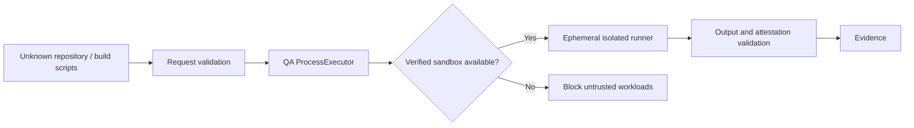

# 第三者コードを実行するQA基盤の脅威モデル

> **文書ステータス:** As-Isの実行器とProposedな脅威対策を分離  
> **調査基準:** DIP `main` `ae2a78f1c168`、将来資料ブランチ `3587122ad05e`（2026-10-16 確認）  
> **注意:** 文書は設計・検証の説明であり、実機・本番運用の成功を新たに証明するものではない。

## 1. 対象資産と攻撃者
顧客の未公開ソース、APIキー、SSH鍵、DB資格情報、QA結果・Artifact、DIPホスト、他テナント、ジョブキューが保護対象。第三者がGitリポジトリ、test script、ビルドコマンド、ログ、モデルの指示を操作できる前提で設計する。

## 2. 脅威境界

**現行との差:** `ProcessExecutor`は設定によりsandbox経路を選ぶ。コード上、ホスト実行経路も存在するため、全パスが必ず強制隔離されるとは断定しない。商用の**非信頼コード**はfail-closedとする運用ポリシーを明文化し、強制する追加検証が必要。

## 3. 脅威一覧（簡易STRIDE）
| Threat | 攻撃例 | 制御案 | 検証方法 |
|---|---|---|---|
| Spoofing | 偽Runner attestation | 実行者IDと署名検証 | 署名改ざん |
| Tampering | 検査途中でテスト書換 | 使い捨てworkspace、digest | Baselineとpost SHA比較 |
| Repudiation | 実行者不明 | Actor/Job/Runnerの監査 | トレース欠損テスト |
| Information disclosure | env/APIキー読取 | host secret非mount、環境サニタイズ | 秘密変数読取プローブ |
| DoS | Fork bomb、disk fill | CPU/RAM/PID/時間/容量制限 | 上限突破テスト |
| Elevation of privilege | privileged container | Capabilities drop、read-only rootfs、非root | host file書込プローブ |
| Network exfiltration | 内部DB/Metadata接続 | Network deny/egress allowlist | 禁止アドレス接続テスト |

## 4. 実装で確認した防御
`QaWorkerSandboxRunner`にはOCI（Docker/Podman）/外部Runner方式があり、外部実行契約`dip.qa-worker.v1`と実行結果のAttestationを扱う。`VerifiedFixService`はtemp worktree/copyとdiff/生成テストのPolicyを扱う。ただし本番安全性はRunnerの構成と実験結果に依存する。

## 5. 防御の境界・未確定事項
- Docker/Podmanが使えることと、ホストカーネルへの侵害耐性は同じではない。
- NVIDIA/AMD GPUパススルーは特殊な攻撃面を増やす。専用VM/Runnerの検討が必要。
- 外部LLMに送るログには任意の文字列が含まれる。Redactionだけでゼロリスクにならない。
- Runner署名に使う秘密、ローテーション、鍵破棄の運用設計が必要。
- 禁止ネットワークを**実際に到達不可と確認した証拠**を保存する。

## 6. 必須の安全性試験
`../../secrets`、symlink escape、環境変数読み取り、ネットワーク外部送信、プロセス残留、リソース枯渇、署名無効化、生成パッチによるSecurity Gate削除。テスト専用の擬似秘密・ネットワーク環境で実施し、第三者環境へ攻撃しない。

## 参照する実装・既存資料

- `src/Dip.Infrastructure/QualityAutomation/ProcessExecutor.cs`
- `src/Dip.Infrastructure/QualityAutomation/QaWorkerSandboxRunner.cs`
- `src/Dip.Infrastructure/QualityAutomation/ProcessSandboxInspector.cs`
- `src/Dip.Infrastructure/QualityAutomation/VerifiedFixService.cs`
- `docs/10-future/architecture/ARCH-003-JOB-ISOLATION.md`

## レビュー・受け入れチェック

- [ ] Third-party QAでhost fallbackを阻止するポリシーが検証される
- [ ] 秘密・ファイル・ネットワークの隔離を攻撃テストで実証する
- [ ] sandbox実装の存在と実際のAttestationを分けて公開する
