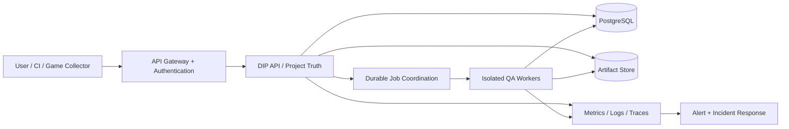

# ARCH-001: 24時間365日運用を目指すサービス構成

**Status: Proposed.** これは将来アーキテクチャ案であり、現時点の本番稼働図ではない。

## 1. 設計の狙い

プロセス再起動、短い通信断、部分障害があっても、利用者のEvidenceが欠損・重複確定・誤判定されにくい構成を目指す。AvailabilityとCorrectnessを別々に検証する。

## 2. 論理構成（選定前の例）

図は責務の説明であり、GatewayやQueueの特定製品採用を意味しない。既存のPostgreSQL-backedジョブやWorkerの実装と整合する範囲で拡張する。

## 3. 失敗への対応

| 失敗例 | 期待する挙動 | 確認方法 |
|---|---|---|
| APIプロセス停止 | 接続の失敗を明示し、復旧後に不正な状態にしない | 再起動試験 |
| Worker終了／Lease喪失 | 二重確定を防ぎ、再実行可否を明示 | Kill・並行実行試験 |
| DB切断 | 完了と見せかけず、期限付き再試行と警報 | ネットワーク故障注入 |
| Artifact保存失敗 | EvidenceをVerified扱いしない | ストレージ障害試験 |
| 過去のテスト結果 | 最新SHAの判定に流用しない | SHA不一致テスト |
| 外部LLM/Engine不在 | NOT_EVALUATED／Blockedと記録 | 依存性喪失テスト |

## 4. 運用上の要件

バックアップ・復元、変更のロールバック、アクセスログ、秘密情報管理、インシデント対応、コスト上限、サービス停止時の案内を運用設計に含める。SLO、RTO、RPOは実測とリスク判断の上で確定し、未計測の数値は約束しない。

## 5. 検証上の境界

CIの成功や単一ホストの長時間起動だけでは「24/365の商用運用実証」にならない。障害復旧を含む現実の運用Evidenceが必要である。

関連：[ARCH-003-JOB-ISOLATION](ARCH-003-JOB-ISOLATION.md)、[SLO-RUNBOOK](../operations/SLO-RUNBOOK.md)。
