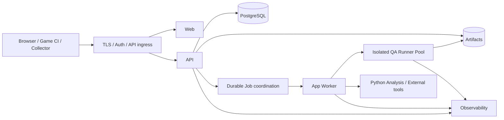

# 商用サービス候補の論理・物理配置設計

> **文書ステータス:** Proposed / 未採用・未本番  
> **調査基準:** DIP `main` `ae2a78f1c168`、将来資料ブランチ `3587122ad05e`（2026-10-16 確認）  
> **注意:** 文書は設計・検証の説明であり、実機・本番運用の成功を新たに証明するものではない。

## 1. サービスの前提
DIPの将来像は制作進行とQAを一つの製品へ統合し、企業・個人クリエイターが継続利用できるサービス。現在の単一開発者用ポートフォリオ・ローカル構成から始め、**検証した要件だけを段階的に採用する**。商用インフラ方式や課金基盤は確定していない。

## 2. 配置候補

この図は**To-Be論理図**。具体的なAPI Gateway、Container Orchestrator、Message Queue、GPU VM、Object Storeの製品選定は未決定。既存のPostgresベースDurable Queueから段階的に拡張する。

## 3. 運用の分離
| Plane | 役割 | 安全上の境界 |
|---|---|---|
| Control Plane | Auth、Project、Plan、Job受付 | Tenant認可、Audit |
| Data Plane | Evidence、Artifact、Claim、Release | 所有権とDigest、Retention |
| Execution Plane | Third-party source・game実行 | Hostから隔離、Network制御 |
| Observability Plane | SLI、Alert、Incident | Secret/PIIの除去 |

## 4. 段階的移行
- Stage 0: 現在の実装とE2Eの再現性を固める。
- Stage 1: 単一テナント、許諾済みサンプルのみでRunner隔離を実証。
- Stage 2: DB/Artifactバックアップ復元、監視・障害注入を導入。
- Stage 3: 管理対象を限定した複数テナントPoC。
- Stage 4: 顧客SLO/運用体制/契約を満たして正式運用を検討。

## 5. 決定を保留する項目
Cloud/On-prem併用、GPUクラスタ、地域・データ所在地、運用費用、災害対策地域、Control/Data Plane境界、カスタマーサポート体制。

## 参照する実装・既存資料

- `docs/10-future/architecture/ARCH-001-24X365-OPERATIONS.md`
- `docs/10-future/architecture/ARCH-003-JOB-ISOLATION.md`
- `docs/02-architecture/architecture-detailed-current.md`
