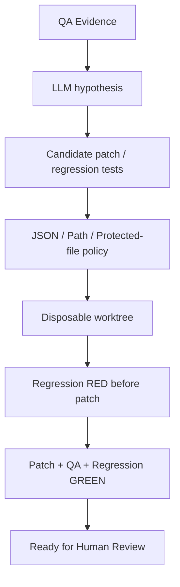

# AI QAの内部構造と安全性

> **文書種別:** 技術解説への入口。本文中の将来計画は実装・実機検証・商用運用の達成を意味しません。

## AIは何をして、何をしないのか
AIはEvidenceを元に原因仮説と修正候補を提案します。しかし、**AIの回答自体は検証結果ではありません**。DIPの`VerifiedFixService`が隔離したワークスペースで回帰テストをRed→Greenまで実行し、必要な検査が揃ってから人間のレビューへ渡します。

## 現行の主な接点
`AutonomousDebugService`、`OpenAiCompatibleFixProposalAgent`、`VerifiedFixService`、`QaWorkerSandboxRunner`。LLM機能はopt-inであり、実際の外部モデルを使った最終SHAのベンチマークなしに実LLMの効果は主張しません。

## 詳しい設計書
- [AI QAの内部詳細設計](https://github.com/MKyosei2/development-intelligence-platform/blob/work/future-product-documentation/docs/02-architecture/ai-qa-internal-design.md)
- [LLM精度・安全性を測る実験仕様](https://github.com/MKyosei2/development-intelligence-platform/blob/work/future-product-documentation/docs/08-testing/ai-qa-evaluation-protocol.md)
- [非信頼コードの実行隔離](https://github.com/MKyosei2/development-intelligence-platform/blob/work/future-product-documentation/docs/07-security/untrusted-qa-threat-model.md)

[QA実装深度](QA-Capability-Matrix) / [システム構成](System-Architecture)
