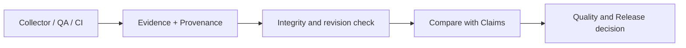

# Evidenceの生成から判断まで

> **文書種別:** 技術解説への入口。本文中の将来計画は実装・実機検証・商用運用の達成を意味しません。

## Evidenceとは
DIPは「完了した」という人間の申告（Claim）と、CI・Tool・ゲームエンジンが観測した結果（Evidence）を分けて扱います。対象のソースRevision・取得時刻・情報源・完全性が一致しなければ、古い結果は現在の品質保証には使えません。

## 代表ケース
CriticalなQA Findingがあるのに`Complete/100%`と申告された場合、根拠と申告の矛盾を`Contradicted`と記録する検証シナリオがあります。**これは合成テストの事例であって、商用ゲームで発生した事故の実績ではありません**。

## 詳しい設計書
- [Evidence改訂版・完全性契約](https://github.com/MKyosei2/development-intelligence-platform/blob/work/future-product-documentation/docs/02-architecture/evidence-provenance-contract.md)
- [Claim判定表](https://github.com/MKyosei2/development-intelligence-platform/blob/work/future-product-documentation/docs/02-architecture/project-truth-decision-table.md)
- [Releaseの判断条件](https://github.com/MKyosei2/development-intelligence-platform/blob/work/future-product-documentation/docs/02-architecture/release-gate-decision-model.md)
- [QA Evidence Case Study](https://github.com/MKyosei2/development-intelligence-platform/blob/main/docs/09-portfolio/QA_EVIDENCE_CASE_STUDY.md)

[3つの柱](Three-Pillars) / [AI QA](AI-QA-Architecture)
