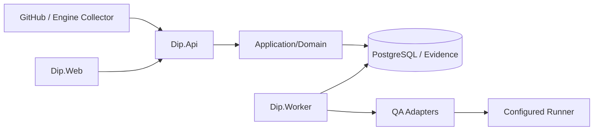

# システム全体のアーキテクチャ

> **文書種別:** 技術解説への入口。本文中の将来計画は実装・実機検証・商用運用の達成を意味しません。

## DIPはどのように動くか
DIPはWeb（画面）、API（認証・外部入力）、Application/Domain（品質・進捗判断）、Infrastructure（DB/実行器）、Worker（非同期処理）、Collector（ゲーム・制作Toolからの情報）を分離しています。

**重要:** 上図は現行コード上の責務を簡略化したもので、特定のCloud製品で商用運用済みという意味ではありません。隔離RunnerやGPU/Engineは環境によって未評価です。

## 詳しい設計書
- [現行システムの詳細設計](https://github.com/MKyosei2/development-intelligence-platform/blob/work/future-product-documentation/docs/02-architecture/architecture-detailed-current.md)
- [QA→Evidence→Releaseのシーケンス図](https://github.com/MKyosei2/development-intelligence-platform/blob/work/future-product-documentation/docs/02-architecture/end-to-end-sequences.md)
- [QAジョブとWorkerの状態遷移](https://github.com/MKyosei2/development-intelligence-platform/blob/work/future-product-documentation/docs/02-architecture/qa-job-lifecycle.md)
- [ProjectとEvidenceのデータモデル](https://github.com/MKyosei2/development-intelligence-platform/blob/work/future-product-documentation/docs/03-database/evidence-and-qa-data-model.md)

[技術設計書の一覧](Technical-Decision-Index) / [AI QA](AI-QA-Architecture)
